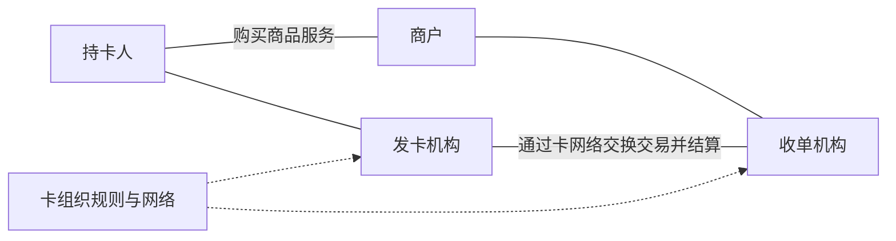
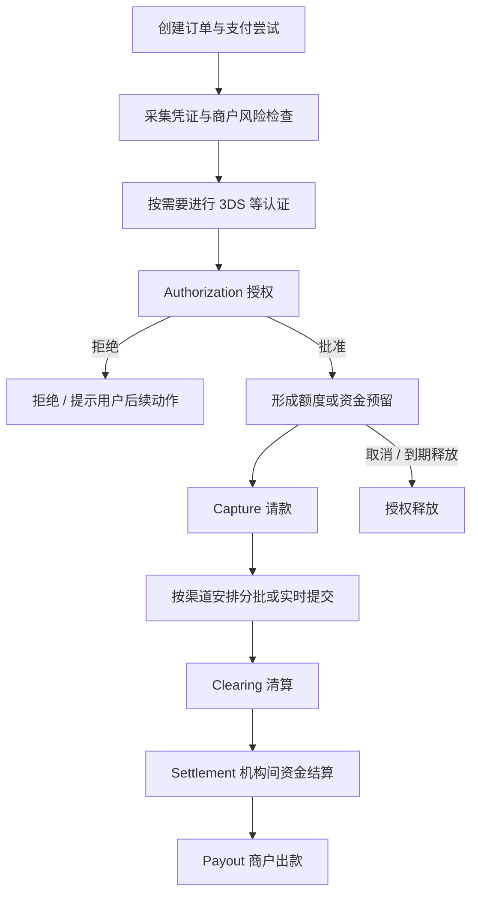
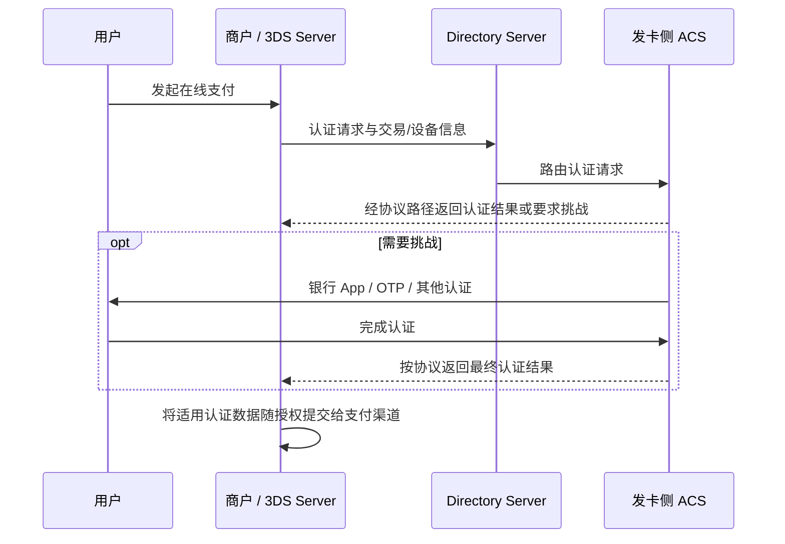
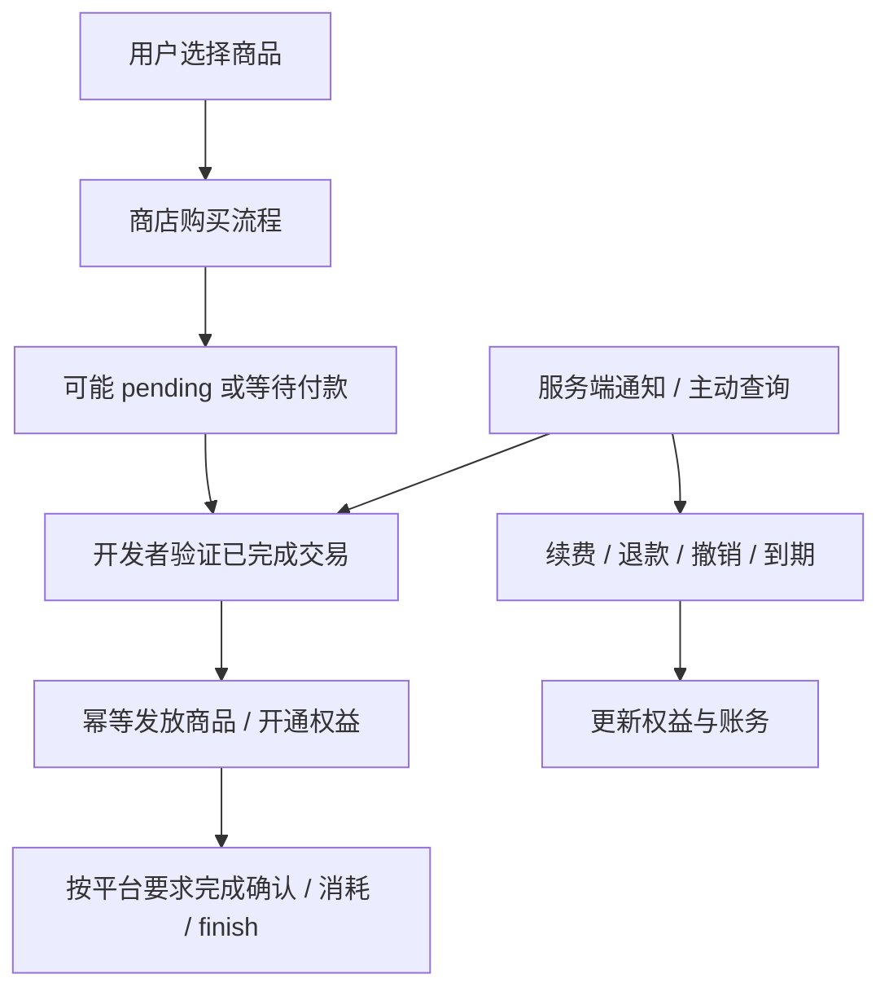

# 境外支付分享笔记：从行业结构、卡支付到 APM、风控与应用商店

版本：学习与分享笔记 v1.0<br>
整理与资料核对日期：2026-10-19<br>
适合读者：支付产品、研发、业务与运营同学；从基础概念逐步进入交易处理与资金运营。<br>
范围：全球支付的通用框架，以新加坡、马来西亚、韩国及国际卡支付为主要例子。

这份笔记把支付看成三个相互关联的问题：**谁有权发起和处理交易，资金怎样完成转移，出现损失时由谁承担责任。** 介绍通用机制时会做适当简化；具体市场的准入、收费、争议权利和交易时限，应以当地法规、支付网络规则与合同为准。文中的费率和汇率计算示例均为教学假设。

术语先统一：原提纲中的“IOS3166”按 **ISO 3166** 理解，“stakhodlers”统一为 **stakeholders**，“aliplu＋”按 **Alipay+** 理解；“卡纸福利的三方支付和四方支付”暂按“卡组织体系中的三方模式与四方模式”展开，另补充卡权益的资金来源。

## 阅读导航

| 章节 | 主要回答的问题 |
| --- | --- |
| 1—2 基础标准与支付分类 | 国家、币种如何表达？Push、Pull、第三方、第四方分别指什么？ |
| 3—4 行业角色与卡组织模式 | 银行、卡组、收单、钱包、BNPL 等分别做什么？ |
| 5—8 卡、POS 与手机钱包 | 卡上有什么？CP/CNP、EMV、NFC、DCC 如何理解？ |
| 9—12 报文、交易生命周期与安全 | SMS/DMS、ISO 8583、认证、授权、清算、退款和 3DS 如何衔接？ |
| 13—14 费率、复购与路由 | 钱如何分配？Network token 和渠道路由怎样影响支付？ |
| 15 APM | PayNow、DuitNow、Alipay+、Kakao Pay 怎样运转？ |
| 16 风控 | 如何控制欺诈、汇率、信用、技术、法律和税务风险？ |
| 17 应用商店支付 | IAP、平台计费与 Apple Pay / Google Pay 有什么区别？ |
| 18—20 案例、术语与分享提纲 | 如何把知识串成一笔完整交易和一次分享？ |

## 1. 两个基础标准：ISO 3166 与 ISO 4217

### 1.1 ISO 3166：表达国家、地区和行政区划

ISO 3166 是国家及其下属区划名称代码标准。支付中常见的是 ISO 3166-1：

| 表示形式 | 示例：新加坡 | 常见用途 |
| --- | --- | --- |
| Alpha-2，两位字母 | `SG` | 支付 API、账单地址、商户国家、发卡国家 |
| Alpha-3，三位字母 | `SGP` | 数据交换、报表与外部系统映射 |
| Numeric-3，三位数字 | `702` | 特定金融报文与统计系统 |

常见映射如下；数字代码应按固定长度处理，避免其他代码的前导零丢失。

| 国家 | Alpha-2 | Alpha-3 | Numeric-3 |
| --- | --- | --- | --- |
| 中国 | CN | CHN | 156 |
| 新加坡 | SG | SGP | 702 |
| 马来西亚 | MY | MYS | 458 |
| 韩国 | KR | KOR | 410 |
| 日本 | JP | JPN | 392 |
| 美国 | US | USA | 840 |
| 英国 | GB | GBR | 826 |

另外两部分是 ISO 3166-2（主要行政区划，例如 `US-CA`）和 ISO 3166-3（已停止使用的国家名称代码）。英国通常使用 `GB`，不能因为域名是 `.uk` 就把所有 API 参数写成 `UK`。电话区号也属于另一套标准，例如新加坡的 `+65` 不是 ISO 3166 代码。参见 [ISO 3166 官方说明](https://www.iso.org/iso-3166-country-codes.html)。

支付系统必须分别保留这些国家属性：

- **Merchant country**：实际签约商户和交易所属商户位置。
- **Acquirer country**：承接该笔交易的收单实体所在市场。
- **Issuer country**：发卡机构或卡账户对应的发卡市场。
- **Customer country**：用户居住地、账单地等业务属性，需说明取值口径。
- **IP / device / shipping country**：网络位置、设备信息、收货地等风险信号。

这些属性可以不同。用户在新加坡使用美国发行的卡，不能把“用户 IP 在新加坡”当作“这是一张新加坡卡”，也不能只依据 IP 判断税务归属。

### 1.2 ISO 4217：表达货币与最小单位

ISO 4217 给货币和部分资金单位分配字母代码、数字代码，并记录 minor unit 信息。货币符号 `$` 具有歧义，接口与账务应使用 `USD`、`SGD` 等明确代码。

| 货币 | 字母代码 | 数字代码 | Minor unit 指数 | 以最小单位表示的例子 |
| --- | --- | --- | --- | --- |
| 美元 | USD | 840 | 2 | USD 12.34 → 1234 |
| 新加坡元 | SGD | 702 | 2 | SGD 12.34 → 1234 |
| 马来西亚林吉特 | MYR | 458 | 2 | MYR 12.34 → 1234 |
| 人民币 | CNY | 156 | 2 | CNY 12.34 → 1234 |
| 欧元 | EUR | 978 | 2 | EUR 12.34 → 1234 |
| 日元 | JPY | 392 | 0 | JPY 1234 → 1234 |
| 韩元 | KRW | 410 | 0 | KRW 1234 → 1234 |
| 科威特第纳尔 | KWD | 414 | 3 | KWD 1.234 → 1234 |

这里的指数表示金额缩放关系，例如指数 2 对应除以 100。不是所有币种都保留两位小数；最小记账单位也不一定等于现金交易的实际舍入单位。代码表应跟踪维护机构更新，参见 [ISO 4217 说明](https://www.iso.org/iso-4217-currency-codes.html) 与 [SIX 官方维护入口及当前币种表](https://www.six-group.com/en/products-services/financial-information/market-reference-data/data-standards.html)。

工程上建议遵守四条规则：

1. 金额与币种成对保存，例如 `{amount_minor: 1234, currency: "USD"}`。
2. 使用整数最小单位或精确十进制处理金额，不使用二进制浮点数直接记账。
3. **ISO 的 minor unit 与渠道 API 的金额约定分别维护**。部分渠道对个别币种有自己的缩放或出款要求。
4. 汇率必须附带报价方向、有效期、来源、加价和舍入规则。`USD/SGD = 1.35` 应明确为 1 USD = 1.35 SGD。

### 1.3 一笔支付可能涉及多种币种

| 币种角色 | 含义 | 示例 |
| --- | --- | --- |
| 展示/定价币种 Display / pricing | 商品页面向用户展示的价格币种 | SGD |
| 交易/提交币种 Transaction / presentment | 实际提交给渠道并由用户确认的交易币种 | SGD |
| 持卡人账单币种 Billing | 发卡行向用户记账的币种 | USD |
| 清算币种 Clearing | 网络交换交易和计算义务所使用的币种口径 | 取决于网络和协议 |
| 结算币种 Settlement | 参与机构实际结算资金的币种 | USD 或 SGD 等 |
| 商户出款币种 Payout | 支付机构向商户银行账户打款的币种 | SGD |

例如：商品 SGD 100，美国卡按 USD 记账，商户收到 SGD。中间仍可能发生换汇。**“用户没有选择美元支付”不代表“整条资金链没有换汇”。**

## 2. 支付的分类：多个维度可以同时成立

### 2.1 Push payment 与 Pull payment

这组分类主要看：**谁向付款人的支付服务提供方提交资金转移指令**。

| 维度 | Push payment，推式支付 | Pull payment，拉式支付 |
| --- | --- | --- |
| 发起资金指令的一方 | 付款人通过自己的银行或支付机构发起 | 收款人依据授权，向付款方账户请求扣款 |
| 常见例子 | 银行转账、信用转账、付款人确认的 PayNow 转账 | Direct debit、商户基于授权提交的卡扣款、部分自动代扣 |
| 用户动作 | 输入收款信息或扫码后确认转账 | 首次付款时同意扣款，或预先授予扣款 mandate |
| 主要风险 | 收款人冒名、付款人被诱导转账、转错账户 | 未授权扣款、重复扣款、授权范围不清 |
| 撤回/争议 | 依支付系统与法律处理，不能假定可即时撤回 | 依卡组/代扣规则可能存在退回或争议权利 |

“用户点击付款按钮”不足以判断为 push。电商刷卡时用户参与确认，但通常仍由商户/收单方向发卡行提交扣款请求；从收款机制看常归为 pull。卡交易中的 CIT/MIT 则是另一个分类维度。

二维码只是呈现和发起交易的载体：既可能装着银行转账信息，也可能是钱包扣款凭据。**扫码支付不天然等于 push payment。** 基础定义可参考 [BIS CPMI 支付、清算与结算术语表](https://www.bis.org/cpmi/publ/d00b.htm)。

### 2.2 其他常见分类维度

| 分类维度 | 分类类型 | 解释 |
| --- | --- | --- |
| 付款与收款主体 | P2P、P2B/C2B、B2B、B2P、G2P、P2G | 个人转账、消费者购物、企业间付款、企业向个人付款、政府补贴、税费 |
| 支付基础工具 | 卡、账户转账、电子货币、现金类凭证等 | 要看底层资金工具，不能只看品牌或按钮 |
| 消费场景 | 线下、线上、App 内、MOTO | MOTO 为邮购/电话订购 |
| 卡或凭证的受理环境 | CP、CNP | Card-present 与 card-not-present |
| 发起参与方式 | CIT、MIT | 消费者主动参与，或商户依据先前协议发起 |
| 频率 | 单次、订阅、分期、不定期代扣 | 分期不一定等于 BNPL，订阅不一定用卡 |
| 处理时效 | 实时、近实时、批量、延迟 | 用户看到成功与机构最终结算可能不同步 |
| 地理结构 | 境内、本地收单、跨境收单、跨境汇款 | 不同网络/法规有不同的认定口径 |
| 记账与清算机制 | 单报文、双报文；逐笔或净额 | 与实时/延迟并非一一对应 |
| 支付用途 | Pay-in、Payout、Remittance | 收款、对外付款、汇款；同一平台可同时经营 |

BNPL 是融资及还款安排，也经常作为一个支付选项出现在收银台。钱包是产品形态，底层可能是卡、银行账户或电子货币。分类时不要把不同维度硬塞进同一层级。

### 2.3 “第三方支付”“第四方支付”与三方/四方卡模式

| 名称 | 常见语境 | 实际描述什么 |
| --- | --- | --- |
| 第三方支付 Third-party payment | 中文支付行业语境 | 银行之外的支付服务机构或支付服务；具体法律定义因市场而异 |
| 第四方支付/聚合支付 | 中文商业或技术语境 | 在多个支付渠道之上提供统一接入、路由、对账等服务 |
| Three-party card scheme | 国际卡组织业务模式 | 卡组织同时承担发卡与收单角色的典型三方结构 |
| Four-party card scheme | 国际卡组织业务模式 | 持卡人、发卡行、商户、收单行组成的典型四方结构 |

“第四方支付”不是全球通用的独立牌照类别。聚合服务是否需要牌照，要看它是否实际提供受监管服务、控制或持有客户资金、承担收单等活动，不能只凭“我们是 SaaS”判断。新加坡的监管框架可从 [MAS 支付监管入口](https://www.mas.gov.sg/regulation/payments) 查起。

### 2.4 境外业务不一定是跨境交易

一家中国公司服务新加坡用户，若由符合要求的新加坡商户实体签约、本地收单、新加坡卡付款，可能构成本地卡交易。反过来，用户身在新加坡，用境外发行的卡付款，可能仍触发卡网络的跨境处理或收费规则。

**跨境与换汇是两件事**：跨境交易可以同币种；本地交易也可能涉及不同账单币种。卡网络对跨境的判断、监管对跨境服务的判断、税法对交易地点的判断也未必相同。

## 3. 支付行业的 stakeholders：角色、职责与利益关系

### 3.1 核心参与者

| 参与者 | 主要职责 | 常见收入来源 | 主要风险或责任 |
| --- | --- | --- | --- |
| Consumer / payer 消费者/付款人 | 发起或授权付款 | 通常不是支付服务收费方 | 盗用、诈骗、重复扣款、汇率与隐性收费 |
| Merchant / payee 商户/收款人 | 提供商品服务、履约、售后 | 商品或服务销售收入 | 欺诈、拒付、退款、未到账、税务 |
| Issuing bank / issuer 发卡机构 | 发行卡、管理持卡账户、授权、账单与持卡人争议 | Interchange、年费、利息等 | 盗刷、持卡人信用风险、合规 |
| Acquirer 收单机构 | 接纳商户、提交交易、商户结算、处理网络规则与争议 | 收单服务费 | 商户履约/倒闭后产生的退款与拒付损失 |
| Card scheme / network 卡组织/网络 | 制定受理和争议规则，提供网络与清算安排 | Scheme / network fees 等 | 网络安全、系统运行、规则与品牌治理 |
| Processor 处理商 | 为发卡或收单方处理报文、交易和账务 | 处理费、系统服务费 | 处理错误、可用性、数据安全 |
| Gateway 支付网关 | 采集/传输支付信息，提供 API、托管收银台等 | 接入费、交易技术费 | 敏感数据与技术运行风险 |
| PSP 支付服务商 | 商户侧整合卡、钱包、银行支付、风控、报表等 | 支付费率、增值服务费 | 取决于其具体承担的业务角色 |
| PayFac 支付便利商 | 在收单安排下服务子商户，简化入网与受理 | 支付分成、平台服务费 | 子商户审核、交易监测与网络责任 |
| Payment orchestrator 支付编排平台 | 多 PSP 连接、规则路由、失败恢复、统一报告 | SaaS/用量费 | 路由失误、重复交易、供应商依赖 |
| E-wallet 电子钱包 | 管理支付凭据、电子货币或钱包账户，提供支付体验 | 商户费、增值服务、合作收入等 | 账户盗用、充值欺诈、资金保障与 AML |
| BNPL 先买后付机构 | 授信、为购买提供短期融资、收取还款 | 商户费、合同允许的消费者费用等 | 借款人违约、欺诈、融资与催收合规 |
| Remittance 汇款服务商 | 跨境收款、换汇、对外付款与到账追踪 | 汇款费、FX spread | AML、制裁、流动性、代理机构风险 |
| SaaS / ISV 软件平台 | 订单、订阅、账单、ERP、业务软件与支付嵌入 | 订阅费、用量费、支付合作分成 | 业务数据与支付数据不一致、责任边界不清 |
| MoR 名义销售商 | 以合同约定的销售主体身份向用户销售并处理相应责任 | 平台/销售服务费 | 税费、退款、争议、消费者义务，按合同与当地法确定 |
| Sponsor / settlement bank 赞助或结算银行 | 提供银行账户、清算接入、资金结算等 | 账户与服务收费 | 合规、对手方、流动性风险 |

**一家公司可以同时承担多个角色。** “它是一家 PSP”并不能直接回答“它是不是收单机构”“谁持有资金”“谁赔偿拒付”。应查看签约法律实体、牌照/网络资格、商户协议和真实资金路径。

MoR 与普通 PSP 的一个实用区别是：前者通常是消费者交易中的销售主体，后者通常为原商户提供支付处理。MoR 不会自动消除开发者的产品、隐私、企业所得税等全部责任。可参考 [Paddle 对购买主体与销售税责任的说明](https://www.paddle.com/help/manage/your/customers/buyers-refunds)。

### 3.2 Government regulators 与 international organizations

| 类型 | 例子 | 关注内容 |
| --- | --- | --- |
| 央行/金融监管机构 | 新加坡 MAS、马来西亚 BNM 等 | 支付牌照、客户资金保障、系统稳定、AML/CFT |
| 制裁主管机关 | 美国 OFAC，以及其他适用司法辖区主管机关 | 特定主体、国家/地区、活动的限制 |
| 数据与消费者保护机关 | 各地隐私监管和消费者保护机构 | 数据使用、跨境传输、误导收费、消费者救济 |
| 税务机关 | IRAS 等 | GST/VAT、销售税、预提税、申报与发票 |
| FATF 金融行动特别工作组 | 国际标准制定机构 | 反洗钱、反恐融资、反扩散融资国际标准 |
| BIS / CPMI | 国际清算银行及其支付与市场基础设施委员会 | 支付基础设施、安全、效率与跨境支付改进 |
| ISO | 国际标准化组织 | 国家、货币、金融报文等标准 |
| EMVCo | 支付技术规范组织 | EMV 芯片、3DS、支付令牌化等技术规范 |
| PCI SSC | 支付卡行业安全标准委员会 | PCI DSS、终端、PIN、移动受理等安全标准 |

FATF、ISO、EMVCo、PCI SSC 的职能与本地发牌机关不同。FATF 标准由各司法辖区通过本地措施落实；PCI DSS 等也不能替代支付牌照。参见 [FATF Recommendations](https://www.fatf-gafi.org/en/publications/Fatfrecommendations/Fatf-recommendations.html)。

### 3.3 分开看信息流与资金流

典型卡交易的请求路径可以概括为：


授权结果沿链路返回。后续资金由发卡与收单侧依网络安排结算，再按合同向商户出款；网关可以只处理信息而不接触资金。**请求经过某家公司，不代表钱必须存放在该公司。**

### 3.4 BNPL、Remittance、SaaS：三个相邻但不同的业务

**BNPL 的两条关系**：消费者购买时，BNPL 方完成适用的身份、欺诈和信用评估；商户按产品规则确认履约并提交收款，BNPL 方或其金融合作方按协议向商户结算；消费者之后依还款计划向相应债权方还款。商户收款时间与消费者每期还款时间不必一致。取消/退款必须同步调整购买与融资关系，不能只在商户订单上改一个状态。具体授权、capture 与退款机制可参阅 [Klarna 交易生命周期示例](https://docs.klarna.com/klarna-network-distribution/after-payments/manage-payment-transactions/)。

**Remittance 的两端资金与中间结算**：付款人在来源国交付资金，汇款服务方完成必要审核和 FX 报价，再通过代理银行链路、本地付款合作方、支付系统互联等实际可用路径，向目的国收款人付款。部分模式会在目的地预置资金，使用户较快收到本地付款；服务机构之间再按安排补充头寸或结算。这不意味着价值转移、合规和结算风险消失。必须解释收款金额、费用、汇率、预计到账时间和失败退款条件。跨境安排的服务水平与责任可参考 [BIS CPMI 跨境支付安排报告](https://www.bis.org/publications/service-level-agreements-cross-border-payment-arrangements)。

**SaaS 的两种收入**：第一种是软件公司向商户收取软件订阅费，商户是软件公司的客户；第二种是软件平台帮助商户接受其终端消费者付款，并可能取得支付合作收入。后者需要明确终端交易的销售主体、商户入网、退款和负余额责任。仅提供软件、成为 PayFac、经营 marketplace、采用 MoR，是不同业务安排。参见 [Stripe 的 SaaS 平台支付示例](https://docs.stripe.com/connect/enable-payment-acceptance-guide)。

## 4. 卡组织的三方模式、四方模式与卡权益

### 4.1 Four-party scheme：四方模式

四个基本角色是：持卡人、发卡机构、商户、收单机构。卡组织提供共同规则与网络，因此图里能出现五个方框，但仍称“四方模式”。Visa、Mastercard 是典型例子。



这种结构允许不同银行和机构分工发卡与收单；某家银行同时发卡、收单，也不因此把整个网络变成三方模式。

### 4.2 Three-party scheme：三方模式

典型三方结构由持卡人、商户、同时承担发卡和收单职能的卡组织构成。American Express 常用于解释这种模式。

现实中存在发卡/收单授权合作方、网络合作和混合结构。因此“某品牌永远只有三个法律实体”并不准确，具体业务需看实际安排。三方与四方的基础区别可参考 [ECB 对卡支付业务模式的解释](https://www.ecb.europa.eu/pub/pdf/other/art2_mb201201en_pp75-86en.pdf)。

### 4.3 Interchange、卡权益与谁出钱

四方模式中，消费交易的 interchange 通常由收单侧向发卡侧支付；它是商户支付成本的一部分，但不是卡组织自身全部收入。发卡行还可能通过年费、利息等获得收入，并承担获客、信用、资金和运营成本。

返现、积分、里程、机场贵宾厅、保险、商户优惠等权益，可能由发卡行、商户、卡组织、合作品牌共同承担。不要把“每一笔 interchange 都直接分给用户”作为账务公式；也不要把商户费率全部理解为银行利润。

## 5. 一张支付卡由什么组成？PAN、有效期、安全码与 BIN

### 5.1 卡面信息与后台账户不是一回事

| 要素 | 英文 | 作用与注意事项 |
| --- | --- | --- |
| 卡号 | PAN，Primary Account Number | 标识卡支付账户或凭证；常见 16 位，也有其他长度，不能只接受 16 位 |
| 持卡人姓名 | Cardholder name | 用于展示及部分校验；不能假定每笔交易都实时严格核验姓名 |
| 到期月/年 | Expiry month / year | 标识凭证有效期，例如 `08/29`；接口需明确两位或四位年份 |
| 卡安全码 | CVV2 / CVC2 / CID 等 | 通常为卡面 3 或 4 位验证码，多用于 CNP 交易 |
| 卡品牌 | Scheme / brand | Visa、Mastercard、Amex 等；一张卡也可能支持多个网络 |
| 芯片、非接触标识、磁条 | Chip / contactless / magnetic stripe | 表示卡支持的受理能力，不是三个互斥的产品种类 |

部分卡将卡号放在背面，或只在 App 展示；虚拟卡没有实体卡面。卡号也不应直接等同于银行存款账户号码。

PAN 常见结构可概括为：发行识别部分、账户识别部分、校验位。许多卡号使用 Luhn 校验，但**通过格式或校验位检查，只能帮助发现输入错误，不能证明卡真实、可用、余额充足或属于当前用户**。

卡面 CVC/CVV 与磁条中的校验数据、芯片动态 cryptogram、PIN 属于不同概念。对商户和收单服务方，卡安全码属于敏感认证数据，授权后不得保留，即使加密或用户同意也不能以复购需要为由存储；相关发卡业务有标准中另行限定的例外。参见 [PCI SSC 关于复购与安全码存储的 FAQ](https://www.pcisecuritystandards.org/faqs/1280/)。

### 5.2 BIN / IIN

BIN = Bank Identification Number；IIN = Issuer Identification Number。“IIN”更准确地反映发行方不一定是传统银行。

历史系统常以卡号前 6 位识别 BIN。标准和卡网络已引入 8 位 BIN，因此系统要兼容 **6 位与 8 位并存**，不能把所有判断固定为 `PAN[0:6]`。BIN 扩展也不意味着卡号整体长度增加。参见 [Visa 8 位 BIN 说明](https://usa.visa.com/content/dam/VCOM/regional/na/us/partner-with-us/documents/8-digit-bin-merchant-infographic.pdf)。

BIN / account range 数据可辅助识别发卡机构、发卡国家、网络、卡产品和资金类型。注意：

- 免费静态 BIN 库可能过期，且同一 BIN 下还可能有更细的 account range 区分。
- BIN 不能可靠推断用户国籍、真实位置、资产情况或每笔交易的账单币种。
- Token PAN 与原始卡 PAN 的属性不一定相同，最好使用渠道提供的标准化元数据。
- 路由、拦截与费率判断，应确认数据来源、粒度和更新时间。

### 5.3 卡数据在业务系统中的边界

推荐通过合规的托管表单、SDK 或受控卡数据环境收集凭证，业务系统保留支付令牌、品牌、末四位及必要展示信息。完整 PAN 的存储需要相应安全控制，**掩码展示与存储保护是两回事**。不要把完整 PAN、安全码、磁道、PIN block 写入日志、埋点、工单或分析仓库。

## 6. 卡的类型与交易类型：分四个轴理解

### 6.1 资金来源或还款结构

| 卡类型 | 主要特点 |
| --- | --- |
| Debit card 借记卡 | 通常连接存款账户，交易减少可用资金或形成冻结 |
| Credit card 信用卡 | 基于授信额度消费，之后还款，可能支持循环信用 |
| Charge card 签账卡 | 通常要求依账单规则全额还款，不能简单视为循环信用卡 |
| Prepaid card 预付卡 | 基于预充值余额或预置价值使用，开放式/封闭式限制可能不同 |
| Commercial / corporate card 商务卡 | 为企业支出、差旅、采购等设计，费用与数据要求可能不同 |

虚拟卡/实体卡是发行载体的区别；一次性卡号、限商户卡号、限额卡号则是凭证与控制能力的区别。

### 6.2 CP 与 CNP

| 类型 | 全称 | 典型场景 | 识别重点 |
| --- | --- | --- | --- |
| CP | Card-present | 插卡、刷磁条、实体卡 tap、手机钱包 tap POS | 受理设备、读卡方式、芯片/非接触数据及网络规则 |
| CNP | Card-not-present | 网购输入卡号、App/网页钱包支付、MOTO、订阅扣款 | 远程凭证、认证数据、电子商务与存卡标识 |

CP/CNP 不是“持卡人是否在商户面前”的简单地理判断。人在柜台前但由商户后台手输卡号，不能自动获得正常芯片 CP 的安全和责任待遇。Apple Pay 在线下 NFC 受理与 App 内支付，也不能仅凭同一个品牌标成同一种环境。

### 6.3 磁条、EMV 接触芯片与非接触

| 技术 | 如何交互 | 核心特点 | 风险与限制 |
| --- | --- | --- | --- |
| 磁条 Magnetic stripe | 刷卡读取磁道 | 主要依赖静态数据 | 较容易遭复制；fallback 需严格控制 |
| EMV 接触芯片 | 插卡，由终端与芯片交互 | 可生成交易相关动态密码，支持多种验证与风险控制 | 需要兼容终端、内核和密钥体系；不消除所有欺诈 |
| EMV 非接触 | 卡或设备靠近读卡器 | 通过非接触接口完成支付应用交互 | 受终端、卡应用、限额和验证规则影响 |
| NFC 手机支付 | 手机与终端近距离通信 | 可承载令牌化卡支付，也可承载其他应用 | NFC 是通信技术，不能单独说明支付网络或资金来源 |

“EMV 芯片”和“NFC 芯片”不是对等的两种支付标准。EMV 描述支付技术与应用规范，NFC 描述近距离通信；同一张双界面卡可以同时支持插卡、tap，甚至还带磁条。参见 [EMV Contact Chip](https://www.emvco.com/emv-technologies/emv-contact-chip/) 与 [EMV Contactless Chip](https://www.emvco.com/emv-technologies/emv-contactless-chip/)。

### 6.4 CVM：如何验证持卡人

CVM = Cardholder Verification Method，常见包括在线 PIN、离线 PIN、签名、No CVM，以及手机上的 CDCVM（Consumer Device Cardholder Verification Method，例如设备生物识别）。

**认证卡片、验证持卡人、发卡行授权是三个不同动作。** 不要求输入 PIN，不代表该交易没有任何认证；刷脸通过，也不代表发卡行一定批准。

## 7. POS：终端形态、交易功能与货币转换

### 7.1 POS 不只是一个“刷卡盒子”

POS 广义上是销售点系统；支付终端是其中采集支付凭证、处理芯片/非接触交互的设备。常见形态包括台式 POS、移动 POS、与收银系统连接的 PIN pad、自助终端，以及 SoftPOS / Tap to Phone。

SoftPOS 可让符合要求的商用手机承担非接触受理功能；是否支持 PIN、具体卡组和场景，取决于整套方案的安全评估、认证与收单支持，不能仅凭“手机有 NFC”就上线。参见 [PCI MPoC 标准说明](https://www.pcisecuritystandards.org/standards/mobile-payments-on-cots-mpoc/)。

### 7.2 POS 常见交易类型

| 功能 | 作用 | 典型场景与注意事项 |
| --- | --- | --- |
| Sale / purchase 消费 | 发起购买支付 | 双报文体系下通常含授权与自动/后续请款安排 |
| Pre-authorization 预授权 | 先预留额度/资金 | 酒店、租车；并非所有渠道支持 |
| Completion / capture 完成/请款 | 对已授权金额发起实际收款 | 可涉及最终金额确认、部分请款 |
| Incremental authorization 增额授权 | 追加授权额度 | 酒店延住等，必须满足网络和行业条件 |
| Void / cancel 撤销 | 在允许阶段停止交易或撤销授权 | 具体是否发送 reversal 取决于渠道 |
| Reversal 冲正 | 撤销/修正先前交易影响 | 常用于授权结果不确定、交易未完成等情况 |
| Refund 退款 | 对已处理交易返还资金 | 可能全额或部分；到账时间与商户提交不同步 |
| Tip adjustment 小费调整 | 按适用规则处理小费金额 | 不能任意突破用户授权或行业限额 |
| Cashback 消费取现 | 购物时从账户额外取出现金 | 与营销“返现奖励”不同，仅部分市场/产品支持 |
| Balance inquiry 余额查询 | 查询支持的账户或卡余额 | 不是所有国际卡/终端都有此能力 |
| Batch close 批次结账 | 提交或关闭交易批次 | 不等于商户银行账户即时到账 |

终端菜单叫“撤销”“取消”还是“退货”，不一定对应相同网络交易；运营手册需要明确适用状态、金额范围和下游动作。

### 7.3 三种常见换汇位置

| 类型 | 在哪里决定换汇 | 用户看到什么 | 商户需要关注什么 |
| --- | --- | --- | --- |
| 按交易币种支付，由发卡侧按规则换汇 | 网络/发卡侧处理账单币种转换 | 本地或商户交易币种金额 | 发卡侧费用及账单金额由其规则决定 |
| DCC，Dynamic Currency Conversion | 商户/收单或 DCC 服务商提供报价 | 支付时选择按卡账单币种等支付 | 明示两币金额、汇率、加价，获取用户主动选择 |
| MCP，多币种定价 | 商户预先提供不同币种价格 | 商品或收银台直接显示用户选择的定价 | 定价策略、交易币种和结算 FX 成本 |

另有**商户结算换汇**：用户交易是 USD，但 PSP 向商户出款 SGD。这并不自动构成消费者侧 DCC。

例：新加坡商品 SGD 100。用户可以按 SGD 支付，由发卡侧转换账单；也可能收到 DCC 提议，直接按一个已报价的 USD 金额支付。DCC 不必然更便宜，按本币支付也不保证没有发卡侧跨境费。应比较完整费用及汇率，不只看按钮上的币种。

DCC 应明确呈现交易金额、转换后金额、汇率和额外费用，并让用户选择；商户不得替用户默认决定。参见 [Visa DCC 官方说明](https://www.visa.com/en-us/personal/travel/dynamic-currency-conversion)。

## 8. Apple Pay、Google Pay、Samsung Pay、Huawei Pay、vivo Pay

### 8.1 手机钱包是一层产品与凭证能力

对典型的绑卡手机支付，可以这样理解：**手机钱包帮助用户安全地提供支付凭证，底层交易仍可能走原有发卡、收单与卡网络。** 钱包里的交通卡、余额账户、银行卡和会员卡，则可能是不同产品体系。

| 产品 | 典型银行卡支付机制 | 理解边界 |
| --- | --- | --- |
| Apple Pay | 设备相关卡令牌、动态交易安全数据，支持门店与远程支付 | 不等于 App Store 的 IAP；普通绑卡支付不以 Apple 存放用户银行卡余额为前提 |
| Google Pay / Google Wallet | 门店 tap 常使用令牌化卡；线上 API 可返回不同类型凭证 | 线上 `PAN_ONLY` 与 `CRYPTOGRAM_3DS` 的处理不能混为一谈；部分市场另有账户支付产品 |
| Samsung Pay / Samsung Wallet | 受支持设备与银行的卡钱包支付 | NFC 及历史部分机型的 MST 能力需按市场、设备核实，不能默认所有设备支持 MST |
| Huawei Pay / 华为钱包银行卡功能 | 设备特定 token，用于支持的银行卡受理场景 | 与华为其他钱包余额/支付产品、应用内计费分别核对 |
| vivo Pay / vivo 钱包银行卡功能 | 支持设备的安全元件、NFC 与合作银行卡能力 | 不等于 vivo 应用商店的应用内计费；不能推断为全球通用受理 |

对应官方资料：[Apple Pay 安全说明](https://support.apple.com/en-ie/101554)、[Google Pay 凭证类型](https://developers.google.com/pay/api/web/guides/resources/payment-data-cryptography)、[Samsung Pay 市场与设备支持](https://developer.samsung.com/pay/merchant/introduction/country-and-device-availability.html)、[Huawei Pay](https://consumer.huawei.com/en/mobileservices/wallet/bankcard/)、[vivo 安全技术白皮书](https://privacy.vivo.com.cn/static/pdf/security-book-pdf.pdf)。这些资料用于解释机制；具体可用银行、设备和地区需查当前支持清单。

### 8.2 从绑卡到一次 NFC 付款

1. 用户申请把卡加入钱包，钱包/令牌服务与发卡侧完成资格及身份校验。
2. 为特定设备或使用场景配置支付 token 和相关安全能力，这叫 provisioning。
3. 用户在门店确认金额，按设备及场景要求完成持卡人验证。
4. 设备向终端提供 token 及动态交易数据，而不是简单复用卡面静态信息。
5. 终端经收单与卡网络向发卡侧提交交易；发卡侧决定是否授权。
6. 后续请款、清算、结算与商户出款依底层受理安排进行。

设备账户号的末四位可能与实体卡不同；客服、退款和查单应保留可关联的渠道交易号，不能只靠实体卡末四位匹配。Apple 对动态交易数据的解释见 [Payment authorization with Apple Pay](https://support.apple.com/en-ca/guide/security/secc1f57e189/web)。

### 8.3 线上钱包仍需完整的服务端支付处理

线上收银台调起 Apple Pay / Google Pay 后，拿到凭证只是一个步骤。商户仍需按接入模式把凭证交给支持该钱包的 PSP/收单渠道，完成授权、请款、回调与对账。

不要把钱包返回的成功 UI 当成商户已收款，也不要把 Google API 中 `CRYPTOGRAM_3DS` 的名称理解成“用户刚刚完成了一次浏览器 3DS challenge”。它描述的是返回的凭证认证方式，实际流程应依官方 API 和渠道要求处理。

## 9. SMS、DMS 与 ISO 8583：处理模式和报文标准

### 9.1 SMS 与 DMS

这里的 SMS 是 **Single Message System，单报文系统**，不是手机短信服务。

| 项目 | SMS：Single Message System | DMS：Dual Message System |
| --- | --- | --- |
| 核心机制 | 一次金融交易报文处理授权及相应金融记账/清算信息 | 授权与后续金融提交/清算分开处理 |
| 直观感受 | 接近一次提交完成交易处理 | 先批准额度，再提交最终收款 |
| 常见场景 | 某些借记卡网络、ATM 与特定支付处理体系 | 许多信用卡与电商卡交易 |
| 延迟/部分请款 | 能力由具体网络决定，不应照搬 DMS 模型 | 常见，但同样需渠道支持 |
| 最终资金结算 | 仍由网络结算安排决定 | 仍由网络结算安排决定 |

“单报文”不等于只发生一个网络数据包，也不等于参与机构立即通过央行资金逐笔结算。“双报文”也不限定商户只能请款一次。参考 [Adyen 对 SMS/DMS 等术语的定义](https://docs.adyen.com/adyen-glossary/)。

### 9.2 ISO 8583 是什么？

ISO 8583 是卡来源金融交易报文的接口标准，描述报文结构、格式和相关数据表达。ISO 官方已有 ISO 8583:2023；生产网络仍可能使用基于更早版本、卡组或处理商定制的 profile。

**ISO 8583 不负责定义所有网络传输方式，也不规定最终资金如何结算。** 两个系统都声称支持 ISO 8583，仍然需要逐字段、逐交易类型联调。参见 [ISO 8583:2023 官方摘要](https://www.iso.org/standard/79451.html)。

常见报文结构可以概括为：

```text
网络/私有报文头 + MTI（消息类型标识）+ Bitmap（位图）+ Data Elements（数据域）
```

下面是行业中常见的**传统 profile 示例**，用于认识概念，不是对所有版本和网络的固定字段要求：

| 示例项 | 常见作用 |
| --- | --- |
| `0100 / 0110` | 授权请求 / 响应 |
| `0200 / 0210` | 金融交易请求 / 响应 |
| `0400 / 0410`、`0420 / 0430` | 不同 profile 中的冲正请求/响应或冲正通知/确认 |
| DE 2 | PAN 或适用的支付账户标识 |
| DE 3 | Processing code，交易处理类型 |
| DE 4 | 交易金额 |
| DE 11 | STAN，系统跟踪号 |
| DE 22 | POS entry mode，凭证读取方式 |
| DE 37 | RRN，检索参考号 |
| DE 38 / 39 | 授权标识 / 响应码 |
| DE 41 / 42 | 终端标识 / 商户标识 |
| DE 49 | 交易币种 |
| DE 55 | 某些 profile 中承载 EMV 芯片数据 |

STAN、RRN、授权码都应结合渠道、日期、商户或原交易上下文使用，不应未经验证就当作全系统唯一主键。MTI、私有域、响应码和长度编码一律以接入网络规范为准。

### 9.3 ISO 8583、ISO 20022、SWIFT 的关系

- **ISO 8583**：常见于卡交易处理。
- **ISO 20022**：金融业务消息建模及消息标准体系，常用于银行支付和金融基础设施；并非某一家公司的独有网络。
- **SWIFT**：提供金融消息等服务的组织与网络。发送一条消息与资金在银行账户间最终转移是不同动作。

不能把“SWIFT 已发出”直接理解成“收款人已经到账”。可参考 [SWIFT 对自身角色的说明](https://www.swift.com/about-us/who-we-are)。

## 10. 卡交易生命周期：从认证到商户到账

### 10.1 常见双报文电商流程



这是教学流程，不是所有交易都按图中独立步骤串行执行。风险检查可以多次发生，认证可在某些情形下省略，自动请款可紧跟授权，单报文交易也不能强套此状态机。

### 10.2 每个阶段到底完成了什么？

| 阶段 | 核心问题 | 主要结果 | 不能据此推断什么 |
| --- | --- | --- | --- |
| Authentication 认证 | 付款身份/凭证是否可信？ | 设备、芯片、PIN、3DS 等验证结果 | 不代表有钱，也不代表一定授权成功 |
| Authorization 授权 | 发卡方是否批准这次交易？ | 批准/拒绝，常伴随额度或资金预留 | 不等于商户银行账户到账 |
| Capture 请款 | 商户是否提交最终收款金额？ | 对授权发出收款指令 | 请求受理不等于后续清算一定成功 |
| Batching 批次处理 | 哪些交易被组织在一起提交？ | 批次/文件/提交记录 | 不是所有网络必有的独立资金状态 |
| Clearing 清算 | 交易数据是否匹配、各方应收应付多少？ | 交易核对、费用与净额/义务计算 | 不等于最终资金转移 |
| Settlement 结算 | 机构间资金义务如何履行？ | 通过约定账户和结算机制完成资金转移 | 不代表商户已经收到 payout |
| Payout 商户出款 | 何时、以何币种向商户付款？ | 商户银行入账或可提取余额 | 不消除后续退款、争议与追偿 |

有的 PSP 在自己的后台把“settled”定义为记入商户应付款，有的指其他资金节点。**内部状态必须定义清楚，并维护渠道映射，不要只做英文状态名的一对一翻译。** 可对照 [支付生命周期](https://docs.adyen.com/account/payments-lifecycle) 与 [报表中的生命周期状态](https://docs.adyen.com/reporting/reports-and-the-payments-lifecycle/)。

### 10.3 为什么要把 authorization 与 capture 分开？

- 电商可先授权，等库存或发货确认后请款。
- 酒店、租车最终金额不确定，可能先预授权再完成。
- 平台服务可能分批履约，需要符合规则的部分或多次请款。
- 发货前取消，可在允许阶段释放授权，避免先收款再退款。

但授权有有效期，超期请款、增额授权和多次请款都有网络/渠道限制。不能把“已授权”当成可无限期保留的收款保证。

### 10.4 例子：USD 100 的电商订单

1. 用户下单 USD 100，完成需要的认证。
2. 发卡行批准授权，用户看到 USD 100 待入账或额度冻结。
3. 商户只发出 USD 80 的商品，渠道允许时请款 USD 80。
4. 剩余 USD 20 按渠道机制撤销或最终释放；不能假定部分请款后立即自动释放。
5. 交易完成清算和结算，商户按合同收到扣除费用等项目后的出款。
6. 此后仍可能发生 USD 10 的部分退款，或用户对未收到货提出争议。

客服应能区分“待入账授权”和“已入账扣款”。用户看到两条记录，也可能是一笔授权加一笔正式入账，必须核实后才能判断为重复收费。

### 10.5 支付超时：结果未知，不等于失败

一种典型故障是：发卡行已经批准，但 PSP 返回响应时网络中断。商户只看到超时，用户却看到冻结。

正确处理思路：

1. 保留原订单、支付尝试号、渠道参考号和幂等键。
2. 将交易标为 `PROCESSING` / `UNKNOWN` 等待确认，不立刻断言失败。
3. 按渠道协议通过查单、回调与对账恢复结果，必要时处理冲正。
4. 在未确认前控制再次发起扣款；跨渠道重试也要防止原交易晚成功。
5. 如果重复成功已经发生，明确取消/退款责任与自动补偿规则。

一次 HTTP 超时不能提供“资金没有变化”的证明。

## 11. Cancel、Void、Reversal、Refund、Chargeback

### 11.1 核心对照表

| 名称 | 典型目的与阶段 | 常见发起方 | 资金影响 | 易混淆点 |
| --- | --- | --- | --- | --- |
| Cancel / void 取消/撤销 | 在允许阶段停止支付或阻止请款 | 用户、商户或系统 | 可能未发生正式收款，或需撤销授权 | “订单取消”不保证“支付已撤销” |
| Authorization reversal 授权冲正 | 撤销全部/部分授权的影响 | 收单、处理商或系统 | 释放预留，具体展示时点由发卡侧处理 | 不等于对已入账交易发起退款 |
| Financial reversal 金融冲正 | 纠正某类已提交金融交易 | 依网络规则 | 反向调整相应金融影响 | 不同于所有 PSP API 中的 `reverse` 语义 |
| Refund 退款 | 对已处理的购买返还金额 | 通常商户主动发起 | 创建与原交易关联的返款 | 接口成功不等于用户立即收到钱 |
| Chargeback 拒付/退单 | 依据网络规则处理消费者/发卡侧争议 | 持卡人联系发卡方后，经发卡侧发起等 | 可扣回商户资金，并可能附加费用 | 不是普通客服退款，不保证商户一定败诉 |

部分 PSP 的 `reverse` 接口会依据原交易状态选择 cancel 或 refund；这是该产品的接口设计，不能把它当作所有网络对 reversal 的统一定义。

### 11.2 Refund 的处理重点

- 通常优先沿原支付路径退回，减少诈骗与对账复杂度。
- 部分退款累计不得超过可退金额；并发退款要控制金额占用和重复提交。
- 退款可能处于处理中、失败、退回或人工处理状态。
- 原卡过期、换卡或钱包 token 变化不一定导致退款失败，但需依渠道机制处理。
- 原支付手续费是否退、是否另收退款费、FX 差额如何承担，要看合同。
- 部分退款、退款币种和退款有效期均不是所有 APM/卡渠道通用的能力。

### 11.3 Chargeback 的生命周期与证据

常见过程是：用户提出争议 → 发卡侧核查/发起网络争议 → 商户被通知与可能被扣款 → 商户接受或提交证据 → 后续复核/升级，部分情形可能进入仲裁。不是每一种争议都经历全部步骤。

| 争议原因 | 可用证据举例 | 日常预防 |
| --- | --- | --- |
| 未授权/欺诈 | 适用认证结果、设备记录、交易关联资料 | 防盗号、3DS 策略、卡测试识别 |
| 未收到货 | 运单、签收、电子服务交付与使用证据 | 准确交付承诺、履约追踪 |
| 重复扣款/金额错误 | 订单与各支付尝试映射、结算记录 | 幂等、查单、账单核对 |
| 已取消仍收费 | 取消时间、条款与授权记录、实际使用情况 | 清晰的取消入口与生效规则 |
| 已退款但未入账 | 退款参考号、金额、时间、原交易关联 | 退款状态追踪与清晰通知 |

证据应与争议原因相关，按规则提交，并符合隐私要求。不要统一写死“所有拒付都是 120 天”或“商户都有相同申诉期”；时限依网络、原因、市场和交易条件而变。可参阅 [Visa 商户争议处理指南](https://bd.visa.com/content/dam/VCOM/global/support-legal/documents/merchants-dispute-management-guidelines.pdf)。

退款与 chargeback 还可能并发：已经退款的交易又收到争议时，需要提交退款证据并核对实际扣账，避免自行重复赔付。

## 12. AVS、CVC 与 3DS：解决不同的安全问题

### 12.1 三类能力的边界

| 能力 | 校验什么 | 典型使用 | 不能证明什么 |
| --- | --- | --- | --- |
| AVS | 提供的账单地址与发卡侧记录的匹配情况，常涉及门牌号/邮编 | CNP 风险信号 | 不能证明当前操作者一定是持卡人 |
| CVC/CVV 校验 | 提供的卡安全码是否与卡数据匹配 | 首次远程付款等 | 不能排除卡面信息整体泄露 |
| 3DS | 通过发卡侧认证机制验证电商交易的可信度 | 在线卡支付认证 | 不保证余额充足、最终授权、商品履约或所有争议免责 |

AVS 的覆盖范围与结果码语义因市场、卡组和发卡方而不同。“未支持”“未执行”“不匹配”必须分开处理，不能一律当作欺诈。参见 [AVS 官方接入说明](https://docs.adyen.com/risk-management/avs-checks/)。

### 12.2 3DS 的三个 domain

3DS = 3-D Secure，三个域通常指 issuer domain、acquirer domain、interoperability domain。常见技术组件是：

- **3DS Server**：商户/受理侧发起认证。
- **Directory Server，DS**：卡网络侧目录与消息路由。
- **Access Control Server，ACS**：发卡侧认证服务。
- **SDK / browser components**：收集设备信息、呈现认证交互。

简化流程：



图用于解释职责，不展示全部协议消息和回传路径。相关标准由 [EMVCo 3-D Secure](https://www.emvco.com/emv-technologies/3-d-secure/) 维护。

### 12.3 3DS 1.0 与 3DS 2.x

| 维度 | 3DS 1.x | EMV 3DS / 3DS 2.x |
| --- | --- | --- |
| 设计背景 | 早期浏览器电商 | 浏览器、原生 App 与更多支付场景 |
| 数据能力 | 相对有限 | 更丰富的交易、设备与上下文数据 |
| 交互形态 | 常见跳转式认证 | 支持无感认证与挑战，App 体验更完整 |
| 风险判断 | 较少上下文 | 通过风险评估决定是否需要额外挑战 |
| 版本理解 | 历史协议 | “2.0”常是泛称，具体还涉及 2.1、2.2、2.3 等版本 |
| 新系统选型 | 不应作为现代接入目标 | 核实渠道、ACS、SDK 支持与当地要求 |

主流网络已推进 3DS 1.x 退场。例如 Visa 的历史迁移资料给出 2022-10-15 的 3DS 1.0.2 退场时间；这个日期应标注为该网络的迁移安排，不能外推为所有地区和历史系统同日切换。参见 [Visa EMV 3DS 迁移资料](https://corporate.visa.com/content/dam/VCOM/corporate/solutions/documents/best-buy-improving-customer-experience-and-reducing-fraud-with-emv.pdf)。

### 12.4 Frictionless 与 Challenge

- **Frictionless flow**：发卡侧基于数据评估完成认证，用户不一定看到额外验证界面。
- **Challenge flow**：发卡侧要求额外验证，例如 OTP、银行 App 确认或其他受支持方式。

因此，**没有短信不代表没有 3DS，收到短信也不代表完成了 3DS**。钱包绑卡短信、商户登录短信、支付确认短信可能属于不同机制。参见 [EMVCo 对两类流程的解释](https://www.emvco.com/knowledge-hub/optimising-online-payment-authentication-with-emv-3-d-secure/)。

### 12.5 认证结果、授权与责任转移

认证成功后，仍要向发卡侧提交授权。应按渠道要求传递 ECI、认证值（名称随网络不同）、交易关联 ID 与版本等数据；丢失或错误映射可能影响授权结果和适用责任安排。

3DS 在满足条件时可能将某些未授权欺诈争议责任转移给发卡侧，但**不覆盖所有拒付原因**。未交货、重复扣款、退款未处理等仍可能由商户承担责任；豁免、尝试认证、特定地区和网络规则也会影响责任判断。

### 12.6 3DS 与 SCA 不是同义词

SCA = Strong Customer Authentication，是特定监管框架下的认证要求。以 PSD2 相关定义为例，通常需要 knowledge、possession、inherence 三类中的至少两类独立要素，并满足适用的其他要求。

3DS 是帮助完成在线卡认证的一套协议；是不是满足 SCA、是否适用豁免或排除，要结合交易与监管条件判断。两个密码并不自动等于两个不同类别的认证要素。参见 [EBA 对独立认证要素的解释](https://www.eba.europa.eu/single-rule-book-qa/qna/view/publicId/2020_5619)。

## 13. Pricing schemes：Blended 与 Interchange++

### 13.1 商户卡支付成本的主要组成

典型四方模式下，可用以下教学公式理解：

```text
商户处理成本 ≈ interchange + scheme/network fees + 收单/PSP 加价与处理费
```

此外可能有跨境、FX、认证、令牌化、最低月费、争议、退款、终端、出款等成本。具体哪些已包含、哪些另外收，需要逐项看合同。

### 13.2 Blended：混合费率

把多类底层成本打包为一个商户报价，常见形式是百分比加固定交易费。不同卡种、跨境或钱包可能另设档位，“混合”不代表所有情形都只有一个价。

假设报价为 **2.9% + USD 0.30**，一笔 USD 100 的手续费是 USD 3.20，暂不考虑其他费用时商户净额为 USD 96.80。

优点是预算和报价易理解；局限是底层成本透明度较低，商户的卡种组合变化未必直接体现在报价上。

### 13.3 Interchange++：拆分底层费用

通常把成本拆为 interchange、scheme fee（第一个“+”）和收单/服务商加价（第二个“+”）。参见 [Adyen 对 Interchange++ 的说明](https://help.adyen.com/en_US/knowledge/payment-methods/explore-payment-methods/what-is-the-interchange)。

假设一笔 USD 100 的交易成本为：

| 组成 | 假设费率 | 金额 |
| --- | --- | --- |
| Interchange | 1.50% | USD 1.50 |
| Scheme fees | 0.15% | USD 0.15 |
| Acquirer / PSP markup | 0.40% + USD 0.10 | USD 0.50 |
| 合计 | 2.05% + USD 0.10 | **USD 2.15** |

在这个假设下商户净额为 USD 97.85。但不能据此断言 Interchange++ 永远便宜：国际卡、商务卡、不同网络与受理条件可能带来不同底层成本，真实报价还可能有固定费用与计费细则。

### 13.4 如何比较两份支付报价？

| 比较项 | 需要问清的问题 |
| --- | --- |
| 卡种与地区组合 | 本地/国际、借记/信用、消费者/商务卡分别占多少？ |
| 收费触发点 | 按 API 调用、授权尝试、授权成功、capture 还是结算收费？ |
| 失败与撤销 | 拒绝、失败、取消是否仍有处理费？ |
| FX | 汇率基准、加价、报价有效期、退款换汇如何计算？ |
| 退款与争议 | 原手续费退不退，是否另收退款/拒付/仲裁费用？ |
| 资金 | 结算周期、储备金、最低出款额、提前出款费是多少？ |
| 增值服务 | 3DS、token、风控、对账、设备和账户服务是否另计？ |
| 服务水平 | 成功率、到账稳定性、支持能力能否抵消表面费率差异？ |

更完整的成本视角是：**渠道费用 + FX 成本 + 欺诈/争议净损失 + 资金占用 + 工程运营成本 + 误拒导致的业务损失。**

### 13.5 结算单不是“交易金额减手续费”一行算完

例如某出款批次，所有项目已统一为 USD，且均在本批次现金结算：

```text
已结算交易          10,000
- 支付费用             300
- 退款                 500
- 拒付                 200
- 新扣储备金         1,000
+ 以前储备金释放       200
= 本批应出款         8,200
```

储备金一般是暂时扣留的应付款，不应简单等同于支付手续费。若费用按月开票、退款从其他余额抵扣或存在其他币种，上述现金公式需要相应调整。

## 14. 卡的复购、Network token 与渠道路由

### 14.1 Card-on-file：存卡后的不同交易

| 场景 | 典型分类 | 用户是否当下参与 |
| --- | --- | --- |
| 用户首次输入卡并付款 | 初始 CIT，可同时建立存卡关系 | 是 |
| 用户下次点击“用已保存卡支付” | Stored-credential CIT | 是 |
| 每月会员自动续费 | Recurring MIT，满足先前协议等条件 | 通常否 |
| 按约定在余额不足时自动充值 | Unscheduled card-on-file MIT，视网络分类 | 通常否 |
| 酒店延迟收费、特定补扣 | 可能属于特定 MIT 业务类别 | 需满足对应规则，不是随意补扣 |

“用了保存的卡”不等于 MIT；关键是用户当下是否主动参与，以及交易依据什么协议。MIT 通常关联先前的消费者交易/授权关系，并携带适当的存卡、发起方与原交易信息。参见 [Visa Card-on-File 说明](https://developer.visa.com/docs/card-on-file-data-inquiry)。

建立复购关系时，应明确保存凭证和后续扣款的同意范围、频率、金额确定方式、取消方式及通知。技术上存有 token 只代表“有可引用凭证”，不代表“可以为任意订单扣款”。

### 14.2 PSP token、Network token 与加密 PAN

| 类型 | 谁管理 | 主要用途 | 可迁移性与限制 |
| --- | --- | --- | --- |
| PSP / vault token | PSP 或卡库 | 用内部标识引用受保护的卡凭证 | 通常绑定该 PSP；转移需专门迁移安排 |
| Network token | 网络令牌服务及相关参与方 | 在网络层以受限 token 替代 PAN，并支持生命周期管理 | 有 token requestor、商户/设备/场景等约束，非任意跨渠道通用 |
| Encrypted PAN | 持有密文与密钥的体系 | 保护原始卡号传输或存储 | 本质仍是可解密的卡数据，不会因加密自动退出 PCI 范围 |

Network token 常涉及 TSP（Token Service Provider）、Token Requestor、token 使用范围限制以及适用的动态密码。手机钱包设备 token 与商户存卡 token 可以应用同类令牌化体系，但约束和用途不同。参见 [EMV Payment Tokenisation 用例指南](https://www.emvco.com/wp-content/uploads/2023/03/EMVCo-Payment-Tokenisation-A-Guide-To-Use-Cases-v2.2.1.pdf)。

### 14.3 Network token 的价值和局限

可能带来的价值包括：减少真实 PAN 暴露、通过使用范围限制降低泄露影响、在参与方支持时跟随换卡更新凭证、减少因卡过期导致的部分失败。

但 token 可能被暂停、撤销或不再具备使用资格；发卡方、卡种、市场、交易和渠道也不一定支持。**Token 不能制造余额、绕过用户撤销授权，也不能保证每笔交易成功。**

Account updater 是另一项相关能力：在参与机构支持的情况下更新原卡凭证信息。它与 network token lifecycle 相互补充，不是同一个功能。参见 [Visa 对更新服务与 token 生命周期的说明](https://developer.visa.com/docs/card-on-file-data-inquiry/docs-how-to)。

### 14.4 复购不该保存 CVC

正确的复购依赖先前同意、可用凭证、交易分类和必要认证，不能把首次收集的 CVC 存下来重复发送。卡换了、用户取消订阅、token 失效或发卡方要求重新认证时，需要相应更新关系或让用户重新参与。

### 14.5 渠道路由：先满足约束，再做优化

渠道路由是为一笔交易选择可用 PSP、收单方、处理连接或支付路径。常见输入包括国家、币种、金额、卡网络/BIN 属性、商户实体、MCC、钱包、token 支持、3DS 结果与渠道运行状态。

推荐的决策顺序：

1. **业务与合规资格**：商户实体、商品、国家、牌照、网络规则是否允许这条路径？
2. **功能与数据兼容**：是否支持所需币种、钱包、token、MIT、capture、退款与争议？
3. **风险及运营约束**：额度、储备金、资金敞口、结算稳定性是否可接受？
4. **经济优化**：综合预期成功率、净收入、费用、欺诈损失、时延等选择路径。

“本地收单”可能改善成本和授权表现，但不能凭空更改商户真实国家、MCC 或交易属性。路由应该传递准确数据，而不是通过错误分类规避规则。

### 14.6 Cascading 与重试的边界

| 情况 | 处理方向 |
| --- | --- |
| 连接建立失败，确定没有提交交易 | 按渠道协议与幂等能力尝试恢复或改道 |
| 超时，是否授权不明 | 先查原交易，控制再次扣款，处理晚到结果 |
| 需要用户认证的 soft decline | 让用户完成适用认证，不是无限换 PSP |
| 临时性资金不足或约定可重试情况 | 在用户协议和网络规则允许范围内安排重试 |
| 失卡、盗卡、明确禁止重试等拒绝 | 停止该凭证重试，要求其他合适的付款方式 |

改变渠道、金额或 token 并不会使不允许的重试变得合规。各网络对拒绝码和重试有具体限制，不应把所有非成功都视为“再试一次”。参考 [Visa 对拒绝后重提交易规则的说明](https://usa.visa.com/dam/VCOM/global/support-legal/documents/updates-to-rules-for-declined-transaction-resubmission-and-use-of-authorization-response-codes.pdf)，实际执行需使用当前适用规则。

### 14.7 怎么评估路由与复购效果？

同时看以下指标，并写清分子、分母和观察窗口：

- 订单支付转化率：最终支付成功订单 / 符合口径的发起支付订单。
- 首次尝试成功率、重试恢复率、最终成功率，分别统计。
- 同一订单重复扣款率，以及长期未决交易数。
- 认证完成率、认证后授权成功率与用户中断率。
- 单成功订单综合成本、欺诈净损失、拒付率及商户资金到账时间。
- 订阅 involuntary churn：因支付失败造成的非主动流失，与主动取消区分。

不能用“成功交易数 / API 调用数”直接代表用户转化；多次重试会改变分母。比较渠道时，还应控制卡种、地区、金额和风险客群差异，避免把不同流量组合误认为路由提升。

## 15. Alternative Payment Methods：本地支付方式如何运转？

### 15.1 APM 是商户视角的集合，不是一套统一网络

APM 常指传统国际卡支付以外的支付方式。不同 PSP 的分类不完全一致，有的也把卡钱包放入 APM 菜单。理解具体方法时，需要继续追问底层是什么。

| APM 类别 | 典型例子 | 底层主要机制 |
| --- | --- | --- |
| 即时账户支付/代理寻址 | PayNow、DuitNow Transfer | 经参与银行/机构与本地转账基础设施完成账户支付 |
| 本地二维码受理 | DuitNow QR、PayNow QR | 二维码携带收款信息或交易凭据，资金依相应系统转移 |
| 银行在线支付 / Pay by bank | 当地银行跳转、开放银行支付等 | 银行认证后发起账户支付；并非所有产品同一机制 |
| 电子钱包 | Kakao Pay、GCash 等 | 钱包余额、账户、卡或组合资金来源 |
| 钱包互联/跨境受理网络 | Alipay+ | 连接收单侧与用户钱包侧，提供路由和相应结算服务 |
| Direct debit | 各地账户代扣系统 | 基于 mandate 的账户扣款，存在本地退回/争议规则 |
| 现金凭证/线下缴费 | 部分便利店、现金账单方案 | 用户凭参考号线下付款，渠道再返回结果 |
| BNPL | 当地受支持的先买后付方案 | 授信、商户收款与消费者分期还款安排 |

不能把所有 APM 都建成“卡支付去掉卡号”的模型。它们可能不支持授权冻结、部分请款、自动续费、原路退款或统一争议处理。

### 15.2 PayNow：新加坡的代理寻址与转账体验

**PayNow 让用户使用手机号、NRIC/FIN、UEN 或适用的 VPA 等标识找到收款账户，底层通过 FAST 等既定服务安排完成新加坡元转账。** PayNow Corporate 常用企业 UEN 关联银行或受支持钱包账户。

简化链路：

```text
用户银行/钱包 App
  → 解析 PayNow 代理标识或二维码，展示适用的收款人信息
  → 用户核对金额和收款人并确认
  → 付款参与机构通过 FAST 等适用链路处理转账
  → 收款参与机构入账
  → 银行或商户 PSP 依据其产品能力通知商户、提供对账记录
```

关键概念：

- **PayNow 与 FAST 不是同一个层次**：前者改善寻址与用户体验，后者是相关资金转账基础设施。
- **PayNow QR** 让转账信息可被扫码读取；动态订单码还能帮助携带金额和关联信息，具体取决于产品。
- **SGQR** 是整合二维码呈现的标准与方案。同一标签可显示多种受支持支付方式，不代表所有方式使用同一资金网络。
- 普通商户通过银行/PSP 接 PayNow，并不等于自己成为 FAST 直接参与者。
- 个人转账记录、收款截图、银行给个人的提醒，与商户可验证的订单回调是不同能力。商户应以自己接入方的服务端通知、查单和对账判断收款。

上述机制可参阅 [ABS PayNow 官方说明](https://www.abs.org.sg/e-payments/pay-now) 与 [ABS PayNow Fact Sheet](https://abs.org.sg/docs/library/paynow_factsheet.pdf)。后者是历史机制资料，参与机构数量应以当前名单为准。

PayNow 也有特定跨境互联安排，但不能因此推断全球所有银行、币种和用户均可使用。国内代理标识可用，也不代表任一跨境产品自动支持该标识。

### 15.3 DuitNow：先分清 Transfer 与 QR

DuitNow 是马来西亚支付体系中的服务品牌。至少应区分：

- **DuitNow Transfer**：使用账户或受支持的 DuitNow ID 等完成转账。
- **DuitNow QR**：使用全国统一二维码受理体系，支持相应银行与钱包参与。
- **跨境 QR 与其他 DuitNow 产品**：参与者、场景和 API 能力要分别确认。

DuitNow QR 的 merchant-presented mode，简化为：


用户扫描商户二维码，在支持的 App 内完成确认；付款和收款参与机构经 PayNet 的 Real-time Retail Payments Platform（RPP）等适用安排交换请求和结果，账户借贷记、超时恢复与后续结算按体系规则处理。

静态码通常复用商户信息，金额可能由用户输入；动态码通常可绑定订单、金额和有效期。另有 consumer-presented mode，即用户展示付款码、商户扫描。**商家展示码与用户展示码，报文方向和风险特征不同。** 参见 [PayNet DuitNow QR 产品概览](https://docs.developer.paynet.my/docs/duitNow-QR/introduction/overview)、[国内商户展示码流程](https://docs.developer.paynet.my/docs/duitNow-QR/integration/merchant-presented-QR/domestic-QR) 与 [消费者展示码](https://docs.paynet.my/docs/duitnow-qr/consumer-presented-qr/overview)。

商户收到即时支付成功，并不意味着自己的 PSP 必须即时出款；如果中间服务商先归集再结算，商户出款周期仍由合同决定。

### 15.4 Alipay+：连接收单与多个用户钱包

Alipay+ 是跨境数字支付受理与互联能力，**不是支付宝钱包本身，也不是所有消费者共用的单一余额账户**。常见结构是：


这里的 MPP = Mobile Payment Provider/Partner，具体称谓依产品文档；ACQP = Acquiring Service Provider。以在线 cashier payment 为例：

1. 商户经收单方创建支付，选择或展示受支持的钱包。
2. 用户被引导至钱包相关界面，确认订单、金额与适用的 FX 报价。
3. 钱包按自己的规则认证用户、检查余额/资金来源并处理支付。
4. 支付结果通过 Alipay+、收单方回到商户；前端也可能跳回商户页面。
5. 后续由相关钱包方、Alipay+ 与收单方按协议进行清算和结算，商户依自身收单合同收款。

Alipay+ 有多种产品与接入模式，上述不是对所有接口的逐消息描述。参见 [Alipay+ Gateway 概览](https://docs.alipayplus.com/alipayplus/alipayplus/gateway_tile/gateway_overview_tile)、[Cashier Payment 产品说明](https://docs.alipayplus.com/alipayplus/alipayplus/product_intro/cashier_payment) 与 [Alipay+ 官方 FAQ](https://www.alipayplus.com/faq/)。

对商户的价值是减少逐一接入钱包的工作，并整合一定范围的 FX、对账和结算。但“接一次”不等于所有钱包、国家、行业、付款场景自动开通；仍有产品能力、合约、商户审核和市场限制。

### 15.5 Kakao Pay：钱包体验与实际资金来源分开看

Kakao Pay 是韩国的支付服务产品。用户侧可使用其支持的 Kakao Pay Money、银行卡等方式；底层资金来源不同，交易处理与凭证也可能不同。

其在线单次支付 API 有一个很适合讲清“认证与最终付款”的流程：

1. **Ready**：商户服务端提交订单信息，获取交易标识 TID 与跳转 URL。
2. **用户认证与选择**：用户进入 Kakao Pay 流程，确认支付方式和交易。
3. **返回商户**：认证成功后按规定返回，带上后续批准需要的参数。
4. **Approve**：商户服务端使用原订单、TID 等关联信息调用支付批准接口。
5. **核对结果与入账**：核对金额、商户、订单、支付状态；按能力处理查询、取消和对账。

**跳转到 success URL 不能替代服务端批准和结果核验。** 接口中的 `approve` 也不应未经分析就映射成所有国际卡语境下同一层次的 authorization。参见 [Kakao Pay 单次支付文档](https://developers.kakaopay.com/docs/payment/online/single-payment) 与 [在线支付功能说明](https://developers.kakaopay.com/docs/payment/online/common)。

韩国境内直连 Kakao Pay，与境外商户通过 Alipay+ 等实际支持它的合作受理网络接入，属于不同路径；签约方、可用资金来源、币种、费用与退款规则需要分别确认。

### 15.6 直连 APM 与间接 APM

“直连”至少有三种含义：**接口直连、合同直签、资金直结**。三者不一定同时成立。

| 比较项 | 直连 APM 提供方/其指定受理实体 | 经聚合 PSP 或其他中间层接入 |
| --- | --- | --- |
| 技术路径 | 商户直接维护该 APM 接口/SDK | 商户接统一 API，由中间方适配 |
| 合同关系 | 通常需逐一签约、审核与维护资格 | 可整合部分入网，但未必只有一份合同 |
| 结算关系 | 可能按该渠道单独结算 | 可能聚合出款，也可能仍渠道直结 |
| 功能可见性 | 较容易直接使用渠道特性 | 取决于 PSP 是否暴露原生能力 |
| 成本 | 可能减少中间加价，但集成与运营成本更高 | 可用规模与服务换取额外费用；不一定总更贵 |
| 稳定性 | 直接承接该 APM 的接口变化和故障 | 中间层增加依赖，也可能提供容灾与统一运维 |
| 对账 | 多渠道多格式 | 可统一报告，但需要保留原渠道可追踪性 |
| 市场扩展 | 单渠道投入更大 | 初期覆盖通常更快，具体取决于可开通范围 |

选择直连前，应证明交易量、功能需求或经济收益足以覆盖：开发、认证、监控、客服、资金运营、退款、争议、对账和合规的持续成本。

### 15.7 APM 必须按能力建模

每接一个方法，至少记录以下能力，而不是只配置名称和 logo：

| 能力组 | 必须核实的问题 |
| --- | --- |
| 用户体验 | Redirect、deeplink、SDK、二维码还是凭证？需要什么 App？ |
| 金额与币种 | 支持哪些币种、精度、限额？展示币与扣款币是否不同？ |
| 生命周期 | 是否有 pending、过期、晚成功？是否支持单独 authorization/capture？ |
| 复购 | 是否支持 mandate、自动扣款和取消？用户是否需每次确认？ |
| 退款 | 是否支持全额、部分、多次、原路退款？有效期多长？ |
| 争议 | 有哪些消费者申诉、网络退回和商户举证机制？ |
| 资金 | 结算方、币种、周期、预充值、储备金和费用如何安排？ |
| 运维 | 通知验签、查询、幂等、对账文件、超时恢复如何工作？ |

并非所有 APM 都提供卡式 chargeback，但这不等于没有退款、消费者投诉、法律追索或损失风险。

### 15.8 二维码过期与晚到成功

用户在付款窗口结束前已确认，但渠道通知晚到；或者商户页面过期，原收款账户却仍然可以收钱。这两类情况都可能出现。

需要预先设计：订单是否可恢复、是否还可履约、是否自动退款、金额不符如何处理、重复付款怎样合并。**本地关闭收银台不是撤销外部资金转移的证明。** 只有渠道具备且确认完成的关单/取消能力，才可能提供相应保证。

## 16. 支付风控应该怎么做？从资金损失倒推控制体系

### 16.1 先建立风险地图

支付风控不只是在付款前计算欺诈分。它还覆盖商户准入、交易过程、出款、退款、对账和供应商管理。

| 风险 | 如何产生损失 | 核心控制 | 观察指标举例 |
| --- | --- | --- | --- |
| 支付欺诈 Fraud | 盗卡、账户接管、卡测试、虚假订单、退款滥用 | 设备/账户关联、速率控制、分层认证、人工复核 | 欺诈净损失/交易额，卡测试命中，误拒率 |
| 授权转账诈骗 APP scam | 用户被诱导主动给骗子付款 | 收款信息核对、异常收款人/行为识别、针对性提示与拦截 | 可疑收款关系、诈骗投诉、损失金额 |
| 汇率风险 FX | 报价锁定与实际兑换之间汇率变化，或退款时逆向敞口 | 有效期、头寸限额、币种匹配、敞口监测及获授权的对冲安排 | 分币种净敞口、报价过期使用率、FX 损益 |
| 信用/对手方风险 | 商户倒闭后退款/拒付；BNPL 借款人违约；PSP 无法兑付 | KYB、授信与结算限额、储备金、合同与集中度管理 | 未履约交易敞口、账龄、负余额、对手方集中度 |
| 流动性风险 | 钱最终可收到，但当前不足以退款、结算或预充值 | 分币种现金预测、周末/假日缓冲、资金调拨与授信安排 | 现金覆盖、预充值余额、逾期出款 |
| 结算风险 | 一方已交付资金而另一方未履行，或清结算中断 | 最终性分析、结算银行和限额、适用的 PvP 等机制 | 未结算金额、失败/延迟结算、账龄 |
| 技术与操作风险 | 超时重复扣款、错金额、回调丢失、账务错误、人工误操作 | 幂等、状态恢复、不可变流水、权限与双人复核 | 重复率、未知态账龄、差错率、恢复时间 |
| 网络安全与数据风险 | 卡号、密钥、账户和个人数据泄露 | 减少敏感数据、分区隔离、加密与密钥管理、访问控制 | 异常访问、密钥事件、漏洞修复时长 |
| 法律/监管风险 | 无牌业务、超范围经营、消费者条款不合规 | 按业务活动和司法辖区审查牌照、合同与销售方式 | 准入缺口、整改项、投诉、监管事件 |
| AML/CFT 与制裁风险 | 通道被用于洗钱、恐融或受限制交易 | CDD/KYC/KYB、UBO、筛查、交易监测、依法报告 | 告警质量、未处理告警账龄、周期复核完成率 |
| 税务风险 | 税率、纳税主体、地点认定、平台代征或申报错误 | 税务责任矩阵、税码、位置证据、发票和退款税调整 | 税额差异、缺失税务证据、申报逾期 |
| 供应商与商业风险 | 单一 PSP 中断、银行解约、费率变化、资金被扣留 | 多方备援、出口能力、合同审核、监测资金和服务 | 渠道集中度、迁移时间、保留款、到账波动 |
| 隐私与模型风险 | 过度收集、跨境数据不合规、模型漂移或不公平决策 | 数据目的与保留规则、最小化、模型验证、申诉机制 | 数据访问问题、分客群误拒、漂移与复核结果 |

上表是系统设计框架，不是每个市场都具有相同的法定义务。监管控制需按业务所在地、服务对象、资金路径和适用法律确定。新加坡的支付服务分类与发牌要求可查 [MAS 支付服务牌照说明](https://www.mas.gov.sg/regulation/payments/licensing-for-payment-service-providers)。

### 16.2 把风险控制放到完整时间线上

```text
商户/用户准入
  → 登录与账户变更
  → 下单与支付前
  → 认证/授权/转账
  → 履约前
  → 商户出款前
  → 退款/拒付/账户关闭
  → 持续复核与审计
```

| 阶段 | 重点动作 |
| --- | --- |
| 商户准入 | 核对真实经营、法律实体、MCC、UBO、网站、交付周期、预计交易和结算账户 |
| 账户阶段 | 识别盗号、异常设备、新账户、密码/手机号变更、收款银行变更 |
| 交易前 | 检查金额、频率、设备、BIN、地理、历史行为与商品风险 |
| 支付中 | 分层认证、处理渠道风险提示、识别异常拒绝率和卡测试 |
| 履约前 | 对高风险实物或不可逆数字交付做复核，保留交付依据 |
| 出款前 | 检查商户可用余额、未履约敞口、退款/争议、异常增长与银行变更 |
| 售后 | 退款授权、原路退、金额并发控制、争议证据和时限管理 |
| 持续运营 | 名单与业务复核、对账、损失归因、模型/规则回看、供应商评估 |

低风险交易可以顺畅通过；中风险可加强认证或复核；高风险拒绝或限制。具体阈值应以客群、商品、市场和真实损失数据校准，不适合复制一套全球固定分数。

### 16.3 汇率风险：先确定谁承诺了什么

假设平台向商户承诺：用户支付 USD 100，商户固定收到 SGD 135。报价基于 1 USD = SGD 1.35；实际兑换时只换到 SGD 133，则在未采取其他安排时形成 SGD 2 的差额。

反过来，如果商户合同写明“按实际结算日汇率换汇”，这部分市场波动可能主要由商户承担，但平台仍有定价透明、计算正确和运营风险。

需要逐项明确：

1. **敞口归属**：用户、商户、PSP、收单方或 FX 提供方谁承担波动？
2. **报价约定**：有效期、保证范围、成交条件、失败/晚成功如何重新报价？
3. **币种头寸**：分币种应收、应付、退款、储备金、预充值余额能否匹配？
4. **逆向交易**：退款按原交易币种处理时，谁承担用户账单差额与商户 FX 损益？
5. **执行与账务**：汇率方向、精度、舍入、手续费和会计汇兑损益分别记录。

可以通过缩短敞口时间、匹配收付币种、设置头寸和交易限额，必要时依财资授权使用适当对冲安排来控制风险。对冲本身也会带来成本、流动性和对手方要求。

### 16.4 信用风险与流动性风险不能混为一谈

- **信用风险**：对方最终可能不还钱，例如商户拿走货款后倒闭，未来拒付无法收回。
- **流动性风险**：对方或自己最终可能有钱，但在应付时点没有足够可用现金。

预售旅游、演出票务、长周期交付等业务，即使当前欺诈很少，也可能积累大量未履约风险。可结合交付周期、退款权利、历史争议与压力情景，确定结算节奏、限额和储备金。

BNPL 中消费者不还款通常首先形成放贷方的信用敞口，但商户是否免责，要看是否无追索、欺诈/退款例外和合同分工，不能笼统写“接 BNPL 后商户没有风险”。

### 16.5 技术风控：支付系统最少要有的控制

1. **业务标识分层**：订单、支付意图、支付尝试、授权、capture、退款、争议、出款分别有标识和关联。
2. **幂等与并发控制**：同一业务动作重复提交不产生重复有效动作；跨 PSP 还需要订单级控制，单一渠道幂等键不覆盖全局。
3. **状态机与未知态恢复**：区分请求受理、处理中、成功、失败、取消和结果未知；允许合法的迟到事件，保护已确认事实。
4. **回调可信性**：验签/身份校验、防重放、事件去重，核对商户、订单、金额、币种；异步安全落库后可靠处理。
5. **查单与补偿**：对超时和漏通知的交易恢复结果，防止“订单失败、钱却收到了”长期悬空。
6. **完整资金流水**：以追加和冲销保留审计轨迹，不直接改余额掩盖差异；按实际资金权责设计复式账务。
7. **多层对账**：订单↔内部支付流水↔渠道交易/结算单↔银行入账；分币种、日期、费用、储备金和跨期核对。
8. **权限与操作审计**：敏感退款、收款账户变更、大额出款、费率和路由变更按风险设置复核。
9. **演练与降级**：覆盖 PSP 故障、回调积压、银行假日、密钥轮换和对账文件缺失。

支付结果与权益发放还需要幂等关联：收到两次成功通知只能发一次货；一笔订单出现两次真实收款则需要明确处理第二笔资金，不能仅把通知去重后忽略。

### 16.6 AML/CFT 与制裁：身份、行为和资金链一起看

KYC/KYB 用于了解客户/企业，UBO 用于理解最终受益所有人，PEP 是政治公众人物相关识别概念。是否需要更深入的尽调与持续监测，应按风险和当地规则决定。

交易监测可关注异常快进快出、结构化拆分、交易与经营不匹配、多个账户共用设备/收款账户、充值后快速退款等信号。单一信号不应自动等同于犯罪结论；需要结合调查、证据与适用报告流程。

制裁筛查需按适用司法辖区和制裁计划考虑姓名、实体所有权/控制关系、地理和业务类型，并在名单或相关资料变化时更新。即时支付速度快，更需要在事前和处理过程中配置相应控制，而不是只等资金转出后检查。参见 [FATF 国际标准](https://www.fatf-gafi.org/en/publications/Fatfrecommendations/Fatf-recommendations.html) 与 [OFAC 即时支付制裁合规指引](https://ofac.treasury.gov/system/files/126/instant_payment_systems_compliance_guidance_brochure.pdf)。

### 16.7 法律与税务：先画责任和业务边界

法律问题至少要回答：谁与用户签约、谁提供支付服务、谁控制资金、在哪些市场展业、谁处理退款和争议、谁对用户展示费用。海外设立一个实体，不代表可以在所有国家自由提供所有支付服务。

税务问题要分开看：

| 问题 | 需要识别的内容 |
| --- | --- |
| 商品/服务销售税 | VAT/GST/销售税是否适用、由谁收取申报 |
| 跨境 B2B/B2C | 客户身份、归属地、逆向征税等条件 |
| 平台/MoR 角色 | 谁被视为供应方、平台是否被认定为代征或销售主体 |
| 支付服务费本身 | 金融服务豁免/应税处理因市场与服务而异 |
| 退款与发票 | 税额冲回、贷项通知单、原税率和跨期调整 |
| 企业与跨境税务 | 常设机构、预提税、转移定价、收入确认等另行评估 |

例如新加坡对符合条件的境外供应商和电子市场经营者有 OVR 安排，涉及面向当地消费者的远程服务和部分低价值商品。是否触发义务要按实际业务与门槛判断，不能凭“由 PSP 代收款”认定税务已经全部处理。参见 [IRAS 境外业务与数字经济 GST 说明](https://www.iras.gov.sg/taxes/goods-services-tax-%28gst%29/gst-and-digital-economy/overseas-businesses)。

### 16.8 如何形成可运营的风控体系？

每个风险都应有：**责任人、风险口径、可执行动作、监测指标、升级路径、证据记录、复核周期**。上线后用真实欺诈、争议、误拒、客户投诉和资金差异持续校准。

看板至少分“支付转化”“欺诈与信用损失”“资金与结算”“系统健康”“合规运营”五组。拒付率应同时保存网络要求的正式口径与内部管理口径；不能将不同卡组的分母、日期归属和监控项目混在一起比较。

## 17. 应用商店支付：IAP、平台计费与手机钱包

### 17.1 先分清四个名字

| 名称 | 主要用途 | 商户/开发者接入什么 |
| --- | --- | --- |
| Apple Pay | 在支持的门店、App 或网页中提供钱包支付凭证 | Apple Pay 能力与支持它的 PSP/收单流程 |
| Apple In-App Purchase，IAP | App Store 体系中的数字商品、功能、订阅购买 | StoreKit、App Store Server API 等 |
| Google Pay | 支持的门店或线上支付体验/凭证接口；具体市场产品不同 | Google Pay API 与支付处理渠道等 |
| Google Play Billing | Google Play 体系中的应用内数字商品和订阅计费 | Play Billing Library、Google Play Developer API 等 |

“在 iPhone App 里付款”不意味着必须调用 Apple Pay；“安卓支付”也不意味着 Google Pay 与 Play Billing 可以互换。Huawei、vivo 等的应用内计费产品，也应与其 NFC 银行卡钱包分别分析。

### 17.2 先按商品与消费场景判断

| 销售内容 | 常见处理方向 | 需要额外核实 |
| --- | --- | --- |
| App 内消费的游戏道具、数字功能、数字内容、订阅 | 通常进入对应商店的数字商品计费政策范围 | Storefront、例外、替代计费计划、当前规则 |
| 服装、外卖、酒店、线下出行等实物/线下服务 | 通常接普通支付渠道，例如卡、钱包、APM | 商品是否确实在 App 外履行/消费 |
| 已在其他渠道购买内容的访问 | 可能适用 reader、多平台、企业等安排 | 是否允许 App 内购买、是否可展示外链与引导 |
| 实时一对一服务、捐赠、混合权益等 | 规则可能有专门分类 | 不能仅看“是服务还是商品”，需分析具体条款 |

截至核对日，Apple 审核规则仍以数字内容/功能 IAP 要求为基础，同时存在地区和品类安排；其 3.1.3(e) 对 App 外消费的实物和服务要求使用 IAP 之外的方式。Google Play 也按支付政策和适用计划处理数字商品及例外。参见 [Apple App Review Guidelines 3.1](https://developer.apple.com/app-store/review/guidelines/#payments) 与 [Google Play 支付政策解释](https://support.google.com/googleplay/android-developer/answer/10281818?hl=en-sg)。

### 17.3 地区、外链与替代计费：不能只看用户 IP

判断依据可能包括商店 storefront、用户资格、开发者计划、分发渠道、应用类别和具体合同。用户旅行到了另一国家，不代表应用就能自动切换到另一套商店收费政策。

“允许替代计费/外链”也不等于没有平台费用或报告义务。可能需要注册计划、展示指定提示、报告外部交易、承担消费者支持，并支付适用服务费。

**2026 年政策更新例子：** Google 官方页面公布了新服务费与 expanded billing choice 的分地区上线安排，并区分 new installs、其他交易及参与项目等条件：

| 官方公布的地区 | 页面列出的上线日期 |
| --- | --- |
| EEA、英国、美国 | 2026-06-30 |
| 澳大利亚、日本 | 2026-09-30 |
| 韩国 | 2026-12-31 |
| 其他地区 | 2027-09-30 |

这是官方页面截至 2026-10-19 的 rollout 安排摘要，不代表每个应用和每笔交易在该日都自动适用相同费率。应继续核对页面中的新安装定义、适用交易、billing fee 与项目资格。参见 [Google Play 新服务费与上线安排](https://support.google.com/googleplay/android-developer/answer/16954621?hl=en)。

因此，不应在财务模型中把“应用商店费率永远是统一的 30%”或“所有订阅一律 15%”写死。应按平台、地区、产品、用户/安装条件、计划资格、交易方式和生效日维护版本化规则。

### 17.4 一次应用内购买的技术生命周期



技术流程应明确区分：**商店交易状态、用户权益状态、开发者应收结算状态**。商店确认用户购买，通常早于开发者收到平台结算款。

### 17.5 Apple：服务端验证与权益管理

现代接入应围绕 StoreKit 与 Apple 签名交易数据、App Store Server API、App Store Server Notifications V2 设计，而不是把旧 `verifyReceipt` 当作新系统唯一主链路。Apple 已将该端点标注为 deprecated。

服务端需要核对签名链和有效性、bundle/app、商品、交易、环境、账户绑定、订阅有效期及撤销信息；使用合适的交易/订阅关联标识做幂等与订阅追踪。通知要验签、去重并处理乱序，漏通知可通过查询恢复。

恢复购买应回到实际交易与权益事实，不能仅凭客户端本地“已经购买”的布尔值；消耗型商品、非消耗型商品与订阅的恢复逻辑也不同。参见 [Apple 交易验证说明](https://developer.apple.com/documentation/storekit/validating-receipts-with-the-app-store)、[Server Notifications V2](https://developer.apple.com/documentation/AppStoreServerNotifications/App-Store-Server-Notifications-V2) 与 [通知接收机制](https://developer.apple.com/documentation/appstoreservernotifications/receiving-app-store-server-notifications)。

### 17.6 Google Play：验证、确认与通知

客户端拿到购买结果后，服务端应使用 Google Play Developer API 等官方机制验证 purchase token 对应的交易与状态，检查商品、包名、账户关联与是否已处理，确认符合条件后幂等发放权益。

对于 pending 购买，不能当作已支付发货。按商品类型和当前 API 规则完成 acknowledgement 或 consumption；遗漏必要确认可能导致平台退款/撤销。RTDN 用于提示状态变化，接收后还应依据官方购买资源获取完整、当前状态。

Apple 的 `finish` 与 Google 的 acknowledge/consume 是各自生命周期中的动作，不能仅因名字近似就映射为相同资金步骤。参见 [Google Play 防欺诈与服务端验证](https://developer.android.com/google/play/billing/security) 与 [Billing 集成生命周期](https://developer.android.com/google/play/billing/integrate)。

### 17.7 订阅：取消续费不等于立即退款或撤权

| 事件 | 常见含义 | 开发者处理方向 |
| --- | --- | --- |
| 用户取消自动续费 | 未来不再自动续费 | 当前已付周期通常仍可使用，按实际到期日处理 |
| Renewal 续费成功 | 产生新的有效付费周期 | 延长权益，防止重复发放 |
| Billing retry / grace period | 续费失败后的重试或宽限安排 | 按平台当前状态和业务政策决定访问 |
| Expired 到期 | 不再有对应有效周期 | 关闭或降级相关权益 |
| Refund 退款 | 平台决定或处理返款 | 核对对应交易与权益影响 |
| Revoke 撤销 | 权益或交易授权被撤回 | 依据已验证的撤销范围处理 |
| Upgrade / downgrade | 产品与计费周期变化 | 处理生效时间、比例计费、订单关联，不能一律立即覆盖 |

还要设计：跨设备恢复、平台账号与业务账号关联、重复订阅、家庭共享（若适用）、从网页转到商店订阅时的重叠周期。不同平台和产品的细则并不完全一致。

### 17.8 应用商店支付的账务与风控

- 对每笔交易分别记录商品价、币种、平台费用、税、退款/调整、开发者应收。
- 交易报告、订阅状态与实际平台出款报告需要关联，不能只依据客户端订单统计收入。
- 防范伪造购买结果、重复 token/交易重放、账号套利、退款后继续享受权益、跨账号转卖权益。
- 平台可能承担部分面向消费者的计费、税务和退款职责；开发者仍需确认自己实体的收入、税务、履约与数据责任。
- 普通卡 PSP、MoR 和商店内购是不同商业安排，比较时要把销售主体、获客/分发、售后、税务与平台费用一起考虑。

## 18. 三个串联案例

### 18.1 境外电商：新加坡商户，美国卡付款

**业务情境**：商品标价 SGD 100，用户使用美国发行的卡；商户经符合资格的收单实体处理交易，收款币种为 SGD。

需要逐层判断：

1. 国家属性：商户、收单、发卡、账单地址、收货地分别是什么？
2. 分类：这是远程 CNP；用户主动结账通常是 CIT；从商户扣款机制看可归入 pull。
3. 凭证：用户手输卡、使用已保存凭证，还是 Apple Pay 等钱包？
4. 安全：是否收集适用 CVC/AVS，是否需要 3DS？认证结果如何送往授权？
5. 资金：授权 SGD 100，何时 capture，何时清算结算、向商户出款？
6. FX：用户以何币种记账？是否选择 DCC？商户出款是否另有换汇？
7. 成本：适用哪些 interchange、scheme、收单与跨境/FX 费用？
8. 售后：退款怎么关联原交易？拒付由谁通知，证据与损失由谁负责？

不能只看到“网页显示新加坡元”和“PSP API 返回成功”就回答整笔交易的成本与到账状态。

### 18.2 本地扫码：马来西亚商户接受 DuitNow QR

用户在银行或钱包 App 扫商户动态码，核对订单金额后确认。付款参与机构、PayNet RPP 与商户收单侧处理支付，商户通过可信通知、查询与对账确认收款。

如果用户页面成功但商户暂未收到通知，应先查询和等待恢复；如果订单已关闭但后来收到真实成功，需要按预案履约或退款。商户最终何时到账，取决于它与受理服务方的结算关系。

### 18.3 数字订阅：网页版存卡与 App Store 内购

网页版可能采用“首次 CIT + 存卡同意 + 之后 recurring MIT”，结合 network token/account updater 管理凭证。

App Store 内购则围绕商店商品、StoreKit、签名交易、续费与服务端通知运转。用户在两端都使用了同一张银行卡，也不意味着开发者可以把商店凭证直接拿到自己的 PSP 做 MIT，或把网页扣款直接当作商店购买。

可以统一业务权益层，但支付凭证、协议、交易事实、退款和账务来源需要保留各自关系，避免同一用户被重复收费。

## 19. 分享时最容易被问到的术语速查

| 术语 | 中文与一句话解释 |
| --- | --- |
| A2A | Account-to-account，账户到账户支付 |
| Acquirer / issuer | 收单方 / 发卡方，分别主要服务商户侧与持卡账户侧 |
| APM | Alternative Payment Method，商户支付选项中的替代方式集合 |
| APP scam | Authorised Push Payment scam，付款人被诱导主动授权转账的诈骗 |
| Authorization | 发卡方或适用支付方批准交易；不等于商户到账 |
| Capture | 对已授权交易发起最终收款/请款 |
| BIN / IIN | 发行识别号码，需考虑 6/8 位与更细账户范围 |
| Batching | 批次组织与提交，不是所有交易必有的独立步骤 |
| Clearing / settlement | 交换核算交易义务 / 履行资金结算义务 |
| Payout | 支付服务方按安排向商户/收款人出款 |
| CP / CNP | 卡/凭证的当面受理环境与远程受理环境 |
| CIT / MIT | 持卡人参与发起 / 商户依据先前约定发起 |
| COF | Card/Credential-on-file，保存凭证的交易关系 |
| CVM / CDCVM | 持卡人验证方法 / 消费者设备上的验证方法 |
| CVV / CVC / CID | 不同卡品牌使用的安全码称呼，需区分卡面与其他校验数据 |
| DCC / MCP | 动态货币转换 / 多币种定价 |
| DMS / SMS | 双报文 / 单报文处理体系；这里 SMS 不是短信 |
| EMV | 覆盖芯片等多类支付技术的规范体系 |
| NFC | 近距离通信技术，不单独定义资金工具或网络 |
| FPAN / token PAN | 原始卡 PAN / 令牌化的账户号码表达；命名依具体系统 |
| Interchange | 典型四方卡购买交易中收单侧向发卡侧支付的交换费 |
| MCC | Merchant Category Code，商户类别码，不是国家代码或商户唯一 ID |
| MID / TID | 商户/终端标识；具体含义依渠道，Kakao 的 TID 则是其交易标识 |
| MDR / MSC | 商户折扣费率/商户服务费的常见称呼，具体包含项依报价 |
| Merchant descriptor | 用户账单上显示的商户描述，影响识别和争议 |
| Mandate | 用户对某类扣款授予的授权安排，不等于单次授权批准 |
| MoR | Merchant of Record，按协议承担销售主体职责的安排 |
| 3DS / ACS / DS | 电商卡认证协议 / 发卡侧认证服务器 / 目录服务器 |
| SCA | 强客户认证，监管要求与 3DS 技术协议需要区分 |
| TSP | 在令牌化语境中指 Token Service Provider |
| KYC / KYB / UBO | 了解个人客户 / 企业客户 / 最终受益所有人 |
| AML/CFT | 反洗钱 / 反恐融资，相关框架还涉及反扩散融资 |
| Reserve | 为特定风险或合同安排扣留的储备金，不等于手续费 |
| IAP / entitlement | 应用内购买 / 用户所获得的功能或内容权益 |
| RTDN | Google Play 的实时开发者通知机制 |

## 20. 一次分享可以怎样讲？

### 20.1 建议的 90 分钟结构

| 时长 | 内容 | 听众应带走的问题 |
| --- | --- | --- |
| 10 分钟 | 标准与支付分类 | 国家、币种、push/pull 和参与方分类为什么不能混用？ |
| 10 分钟 | 行业角色与三方/四方模式 | 谁发卡、谁收单、谁制定规则、谁承担损失？ |
| 15 分钟 | 卡、POS、手机钱包 | PAN、BIN、CP/CNP、EMV、NFC 与钱包分别处于哪一层？ |
| 20 分钟 | 生命周期与安全 | 为什么认证、授权、请款、清算、结算、出款不是一个状态？ |
| 10 分钟 | 成本、复购与路由 | 收费如何拆解？怎样安全提高复购与支付成功？ |
| 10 分钟 | APM | 四个例子分别是什么体系、钱怎样到商户？ |
| 10 分钟 | 风控与应用商店 | 损失怎样发生？IAP 与普通支付如何区分？ |
| 5 分钟 | 讨论 | 用一笔真实业务交易验证各层理解 |

### 20.2 自查与讨论题

1. 同样叫“三方支付”，在中文支付机构语境与卡组织语境分别是什么意思？
2. 用户通过了 3DS，为什么仍然可能付款失败？成功后为什么仍可能拒付？
3. 为什么手机贴 POS 的 Apple Pay 与 App 内 Apple Pay 的受理环境不同？
4. 单报文交易是不是代表银行间和商户都即时到账？
5. 商户取消订单后，为什么用户还可能看到资金冻结或后续扣款？
6. 每个月自动扣会员费，与用户每个月点一次“用保存卡支付”，为什么分类不同？
7. Network token 为什么不等于任意渠道都可使用的通用支付密钥？
8. PayNow、FAST、SGQR 分别解决什么问题？
9. Alipay+ 与一个具体用户钱包是什么关系？Kakao Pay 的成功跳转为何还不足以发货？
10. 一份报价便宜 0.2%，但成功率、资金占用和拒付风险更差，应该怎样评价？
11. 境外公司收到了钱，为什么还需要另行判断税务与支付牌照？
12. 用户取消应用商店自动续费，为什么不能直接立即撤销当前已付权益？

### 20.3 深入阅读顺序

先阅读 ISO / SIX 的国家与币种说明，建立数据表达；再读 ECB / BIS 的角色与支付体系定义；卡技术深入 EMVCo、PCI SSC 与实际卡组规则；APM 看 ABS、PayNet、Alipay+、Kakao Pay 的原生文档；地区合规、税务和商店政策回到各监管机关、税务机关及平台官方资料。

文中链接均紧邻相应概念。标准概览适合建立框架，生产接入仍需要取得实际渠道的接口规范、认证要求、有效规则和合同，尤其要确认报文 profile、金额精度、状态语义、时限、退款/争议权利与资金责任。
